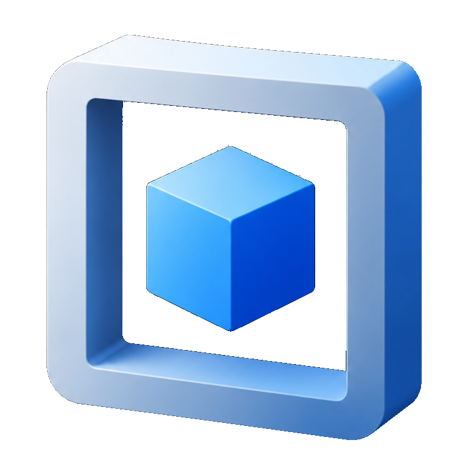

<p align="center">
  
</p>

<h1 align="center">Square</h1>

<p align="center">A lightweight cross platform 3D engine in C++17.</p>

## Overview

Square renders with DirectX 11, OpenGL 4, Metal and Vulkan (Windows) from a single set of HLSL shaders, cross compiled by HLSL2ALL. Each driver is a separate library, chosen at run time.

| Area | What it has |
|---|---|
| Rendering | Deferred and forward pipelines, PBR and Legacy (Blinn Phong) materials, cascaded shadows |
| Post effects | SSAO, Bloom, screen space reflections (deferred) |
| Textures | BC1/BC3/BC4/BC5 (DDS) and ASTC 4x4 (KTX) with mipmaps, PNG fallback |
| Scene | Actors and components, worlds and levels, automatic serialization (binary and JSON) |
| Tools | `Model`: glTF/GLB to engine assets (actors, meshes, materials, compressed textures); `ShaderPack`: the shaders of a game translated offline; `AssetPack`: the archives of a game for the release of a platform |

The examples are `HelloWorld` and `HelloWorldCSM`.

### The engine in a game

A game can keep the engine in a folder of its own (a git submodule, `engine/`) and add it to its
CMake project: `add_subdirectory(engine)`, then `target_link_libraries(<game> PRIVATE Square)`
(the definitions of the configuration come with it). The examples are not built then
(`SQUARE_BUILD_EXAMPLES`), the tools are. At run time the game says where the engine is, relative
to its resource folder (the working folder): `context().engine_dir("engine")`; its paths of the
engine are `context().engine_path("common/...")`.

## Requirements

**Windows**: Visual Studio 2019 or newer, CMake 3.15+, Python 3.6+.

**Linux**:
```bash
sudo apt install build-essential gdb cmake python3 python3-dev python3-pip \
                 libgl1-mesa-dev libglu1-mesa-dev libx11-dev \
                 libxinerama-dev libxcursor-dev libxi-dev libxrandr-dev
```

## Build

Clone with the submodules (glm, zlib, glad, HLSL2ALL, astc-encoder, Vulkan-Headers, volk, VulkanMemoryAllocator):
```bash
git clone --recursive https://github.com/Gabriele91/square.git
cd square
```
Already cloned? Run `git submodule update --init --recursive`.

Then configure and build:
```bash
mkdir build
cd build
cmake ..
cmake --build .
```
On Windows `cmake ..` generates a Visual Studio solution; `cmake -G Ninja ..` from a VS developer prompt works too.

The Vulkan driver needs no SDK to build or run (the loader of the system, by volk). The
[Vulkan SDK](https://vulkan.lunarg.com/) adds the validation layers, enabled by the debug flag of
the context (`-d` in the examples).

## Android

A game is a `NativeActivity` (no Java code) over Vulkan 1.1 (`arm64-v8a`, Android 10+): the
platform layer in `source/Driver/Android`, the Vulkan surface and the times of its presents in
`SqVulkan`. The CMake modules of `cmake/` (in `CMAKE_MODULE_PATH`) build it:

- `SquarePlatform.cmake`, included by the game before its `project()`: `SQUARE_PLATFORM` desktop
  or android (the NDK of the Android SDK, its toolchain, `arm64-v8a`, `android-29`, `c++_shared`);
- `square_add_game(<target> <sources>)`: the executable of the game, on Android the library of its
  NativeActivity (`lib<target>.so`, its `android_main` by `square_main`, SquareMain.h);
- `square_android_app(<target> NAME <name> PACKAGE <package> [ICON] [SPLASH_COLOR] [ORIENTATION]
  [VERSION_NAME] [VERSION_CODE] [RESOURCES <paths>])`: on Android the APK of the configuration in
  the build of everything (`<target>_apk`: the libraries of the build in the Gradle project of the
  game, `<build>/android/<target>` from `cmake/android`, Gradle only packs them) and its deploy:
  `<target>_android_install`, `<target>_android_push` (the resources, `SQUARE_ANDROID_PUSH` more of
  them), `<target>_android_run`, `<target>_android_log`;
- `SquareAndroidPackage.cmake`, `SquareAndroidPush.cmake` (`cmake -P`): the libraries in the APK;
  the resources, `args.txt` (the command line) and `env.txt` (the environment) of the game on the
  device.

It needs a JDK 17 (`SQUARE_ANDROID_JAVA_HOME`: `JAVA_HOME`) and the Android SDK with its NDK
(`SQUARE_ANDROID_NDK_VERSION`, else the newest one). The Gradle wrapper of `cmake/android` is
Gradle's (Apache 2.0, its `LICENSE` there).

## Assets

```bat
build\bin\Model.exe -i model.glb -o assets\model -n model -f bgz -r 1024
```
Textures are written for every platform by default (`-m all`: the PNG, its DDS in BC for the
desktop, the url of the texture, and its KTX in ASTC for the mobiles next to it); `-m bc`, `-m astc`
one of them, `-m png` uncompressed. See [tools/Model/README.md](tools/Model/README.md).

### The archives of a release

`AssetPack` makes the archives (`.sqz`) of a game for a platform: each texture in the compression of
its GPUs (desktop: BC in DDS; mobile: ASTC in KTX) from the best image it has (one already in that
compression, else its image not compressed: a file, its fallback or its bytes in the `.sqtex`,
else the image of the other compression decoded and compressed again), the same images in one
file, the images no texture uses removed (the fallbacks too, `-f` keeps them). Its report
(`assetpack_<platform>.txt`): each archive, each texture, and the files more archives have the same.

```bat
buildin\AssetPack.exe -t android -i assets -o releasendroidssets
buildin\AssetPack.exe -t windows -i assetsrena.sqz,assets	itle.sqz -o release\windowsssets
```

`cmake/SquareRelease.cmake` makes the release of a game: the desktop and Android built in their
configurations (Release, Retail), installed, their archives (`AssetPack`) and their shaders
(`ShaderPack`) for their platform, in `release/` (desktop: the game installed; Android: the APK and
`files/`, the resources to push in the files of the application):

```bat
cmake -P engine\cmake\SquareRelease.cmake
cmake "-DPLATFORMS=android" "-DCONFIGS=Retail" "-DARCHIVES=arena.sqz;title.sqz" -P engine\cmake\SquareRelease.cmake
```

## Shaders

The shaders are HLSL; at run time each one is translated for the driver started (HLSL -> SPIR-V ->
GLSL, GLSL ES, MSL, HLSL or the SPIR-V of Vulkan) and kept in a cache
(`<app data>/square/shader_cache`): the first run of a shader translates it, the next ones read it.
A game can ship them already translated: `ShaderPack` translates every effect and shader of its
resource files for every target of a platform (all its languages, all the capabilities of their
drivers, all the gamma corrections) and packs them in **one archive per platform**,
`shaders.sqz`. The engine reads it from the resource folder of the game (`Filesystem::resource_dir`)
before its cache, whatever driver it starts:

| Platform | Languages in the pack |
|---|---|
| `windows` | GLSL, HLSL, SPIR-V (Vulkan) |
| `linux` | GLSL, GLSL ES, SPIR-V |
| `android` | GLSL ES, SPIR-V |
| `macos` | GLSL, MSL |
| `ios` | GLSL ES, MSL (iOS) |

From the resource folder of the game (where its `resources.rs` is):
```bat
<build>in\ShaderPack.exe -r resources.rs -o build\shaderpack -p shaders.sqz
```

| Option | Meaning |
|---|---|
| `-r` | the resource files (`.rs`) of the effects and shaders, separated by `,` (the engine's `common/common.rs` always) |
| `-o` | the folder of the translations, by language (`<language>/<hash>.sqsh`); the folders of the languages of the platform are made again |
| `-p` | the archive of that folder made at the end (`shaders.sqz`) |
| `-t` | the platform (default: this one); e.g. `-t android -p shaders_android.sqz`, renamed `shaders.sqz` in the package of that platform |
| `-g` | the gamma corrections of the game: `all` (default), `on`, `off` |
| `-b` | the backend the tool starts (`ogl` by default, `d3d`, `mtl`): it only translates, it compiles nothing for it |

The report, `<output>/<platform>.txt`, lists each target, the effects and shaders loaded, the
failures and the translations of each language.

A translation is found by the hash of what made it (the source with its includes and defines, the
target, the version of the cache, `Resource::ShaderCache::version`): the pack is made again when
the shaders change or the engine changes its translations (a new version). A shader not in the
pack is translated at run time, as without it.
